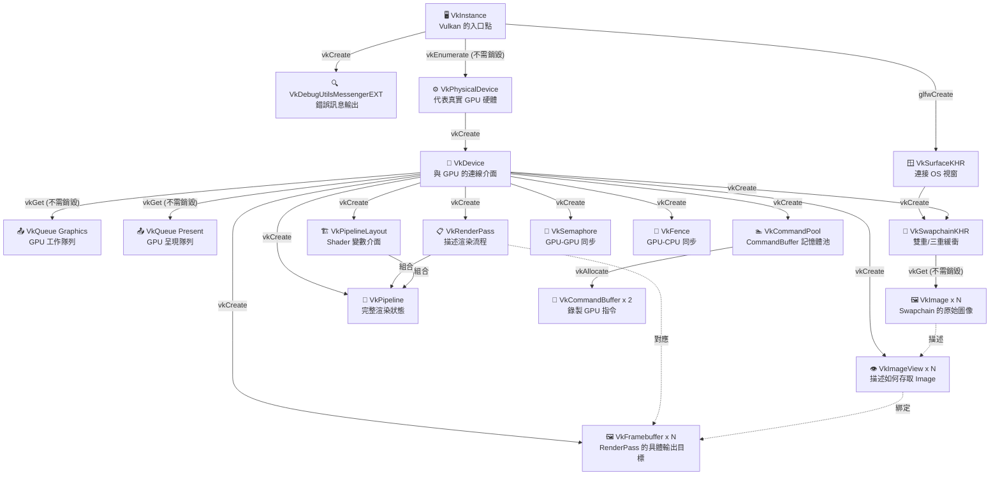
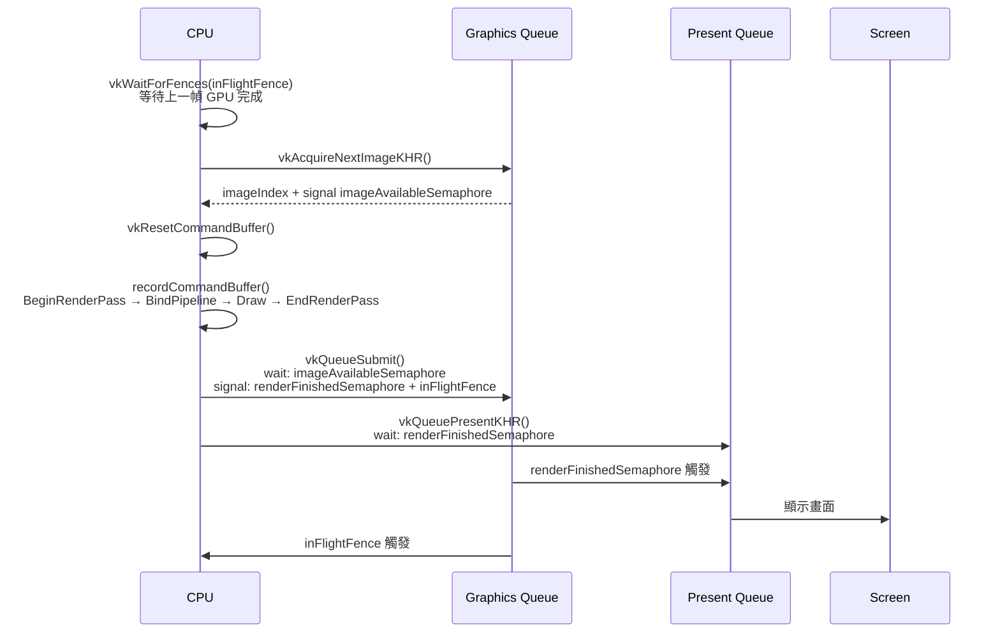

# Vulkan 物件關係圖

> 本文件描述 `vulkan-sample` 專案中所有 Vulkan 物件的依賴關係、生命週期與資料流。

---

## 一、所有權樹狀圖（誰擁有誰）

物件之間有嚴格的父子關係。**父物件銷毀時，它擁有的子物件一起消失**。
用 `vkCreate*` 建立的物件你要自己銷毀；用 `vkGet*` / `vkEnumerate*` 取得的由父物件管理。



---

## 二、建立與銷毀順序

> 建立順序 = 1 → 14，銷毀順序 = 14 → 1（LIFO）

| 順序 | 物件 | 建立函式 | 銷毀函式 | 需要手動銷毀 |
|:---:|---|---|---|:---:|
| 1 | `VkInstance` | `vkCreateInstance` | `vkDestroyInstance` | ✅ |
| 2 | `VkDebugUtilsMessengerEXT` | `vkCreateDebugUtilsMessengerEXT` | `vkDestroyDebugUtilsMessengerEXT` | ✅ |
| 3 | `VkSurfaceKHR` | `glfwCreateWindowSurface` | `vkDestroySurfaceKHR` | ✅ |
| 4 | `VkPhysicalDevice` | `vkEnumeratePhysicalDevices` | — | ❌ 硬體本身 |
| 5 | `VkDevice` | `vkCreateDevice` | `vkDestroyDevice` | ✅ |
| 5.1 | `VkQueue` | `vkGetDeviceQueue` | — | ❌ Device 擁有 |
| 6 | `VkSwapchainKHR` | `vkCreateSwapchainKHR` | `vkDestroySwapchainKHR` | ✅ |
| 6.1 | `VkImage` (swapchain) | `vkGetSwapchainImagesKHR` | — | ❌ Swapchain 擁有 |
| 7 | `VkImageView × N` | `vkCreateImageView` | `vkDestroyImageView` | ✅ |
| 8 | `VkRenderPass` | `vkCreateRenderPass` | `vkDestroyRenderPass` | ✅ |
| 9 | `VkPipelineLayout` | `vkCreatePipelineLayout` | `vkDestroyPipelineLayout` | ✅ |
| 10 | `VkPipeline` | `vkCreateGraphicsPipelines` | `vkDestroyPipeline` | ✅ |
| 11 | `VkFramebuffer × N` | `vkCreateFramebuffer` | `vkDestroyFramebuffer` | ✅ |
| 12 | `VkCommandPool` | `vkCreateCommandPool` | `vkDestroyCommandPool` | ✅ |
| 12.1 | `VkCommandBuffer × 2` | `vkAllocateCommandBuffers` | `vkFreeCommandBuffers` | ✅ (或隨 Pool 銷毀) |
| 13 | `VkSemaphore` | `vkCreateSemaphore` | `vkDestroySemaphore` | ✅ |
| 14 | `VkFence` | `vkCreateFence` | `vkDestroyFence` | ✅ |

---

## 三、物件生命週期分析

物件依照生命週期長短可分為三類：

### 🏛️ 程式啟動時建立，結束時銷毀（一次性）

```
Instance → DebugMessenger → Surface → PhysicalDevice
→ Device → Queue → RenderPass → PipelineLayout → Pipeline → CommandPool
```

這些物件整個程式生命週期都不變。

### 🔄 Swapchain 相關（視窗大小改變時需要重建）

```
Swapchain → Images → ImageViews → Framebuffers
```

當使用者調整視窗大小時，這一組需要全部銷毀後重建。
這也是為什麼這個專案暫時禁用了視窗 Resize（`GLFW_RESIZABLE = false`）。

### ⚡ 每幀重複使用（每幀重置，不重建）

```
CommandBuffer  →  vkResetCommandBuffer() 每幀重置後重新錄製
Semaphore      →  GPU 自動重置，不需手動操作
Fence          →  vkResetFences() 每幀手動重置
```

---

## 四、每幀的資料流



---

## 五、VkRenderPass vs VkFramebuffer 的關係

這兩個物件經常讓人混淆：

| | VkRenderPass | VkFramebuffer |
|---|---|---|
| 性質 | **抽象描述**（藍圖） | **具體實例**（實體） |
| 描述什麼 | Attachment 的格式、數量、Layout 轉換規則 | 實際綁定哪個 ImageView |
| 數量 | 1 個 | N 個（N = Swapchain Image 數量） |
| 類比 | 函式簽名（宣告參數型別） | 函式呼叫（傳入實際引數） |

```
RenderPass  說：「我需要一個 B8G8R8A8_SRGB 格式的 Color Attachment」
Framebuffer 說：「那個 Attachment 就是 swapchainImageViews[i]」
```

---

## 六、同步物件的索引邏輯

本專案使用 **2 個 Frame-in-Flight**，**3 個 Swapchain Image**，因此：

```
imageAvailableSemaphore[2]   → 按 currentFrame 索引（0 或 1）
renderFinishedSemaphore[3]   → 按 imageIndex 索引（0、1 或 2）
inFlightFence[2]             → 按 currentFrame 索引（0 或 1）
```

> ⚠️ `renderFinishedSemaphore` 必須按 **imageIndex** 索引，而非 currentFrame。
> Swapchain 在 Present 後會繼續持有這個 Semaphore，直到那張 Image 再次被 Acquire。
> 若用 currentFrame 索引，可能在 Swapchain 還未釋放時就重複使用它，導致 Validation 錯誤。

---

## 七、Graphics Pipeline 的組成

`VkPipeline` 是整個程式中最複雜的物件，它是以下所有設定的集合：

```
VkPipeline
├── Shader Stages
│   ├── Vertex Shader   (shader.vert.spv)
│   └── Fragment Shader (shader.frag.spv)
├── Fixed-Function States
│   ├── Vertex Input       → 頂點資料格式（目前為空，頂點寫死在 Shader）
│   ├── Input Assembly     → 拓樸：TRIANGLE_LIST（每 3 頂點一個三角形）
│   ├── Viewport & Scissor → 繪製區域：整個視窗
│   ├── Rasterizer         → 填充模式（FILL）、背面剔除（BACK）
│   ├── Multisampling      → MSAA（目前關閉，1 sample）
│   └── Color Blending     → Alpha 混合（目前關閉）
├── VkPipelineLayout       → Descriptor Sets 和 Push Constants 介面（目前為空）
└── VkRenderPass reference → 這個 Pipeline 對應哪個 RenderPass 的哪個 Subpass
```

> Pipeline 一旦建立就**不可修改**。要切換渲染模式（例如線框 vs 填充），
> 必須建立兩個不同的 Pipeline，在 CommandBuffer 中用 `vkCmdBindPipeline` 切換。

---

## 八、CommandBuffer 錄製的指令結構

```
vkBeginCommandBuffer()
│
├── vkCmdBeginRenderPass()
│   ├── 指定：Framebuffer（輸出目標）
│   ├── 指定：Clear Color（背景色）
│   └── 觸發：Image Layout → COLOR_ATTACHMENT_OPTIMAL
│
│   ├── vkCmdBindPipeline()
│   │   └── 告訴 GPU 用哪個 Pipeline（Shader、狀態設定）
│   │
│   └── vkCmdDraw(3, 1, 0, 0)
│       ├── vertexCount   = 3（三個頂點）
│       ├── instanceCount = 1（不做 Instancing）
│       ├── firstVertex   = 0（gl_VertexIndex 從 0 開始）
│       └── firstInstance = 0
│
├── vkCmdEndRenderPass()
│   └── 觸發：Image Layout → PRESENT_SRC_KHR
│
vkEndCommandBuffer()
```

> `vkCmd*` 系列函式不會立刻執行，只是把指令**寫入 CommandBuffer**。
> 直到 `vkQueueSubmit()` 之後，GPU 才開始真正執行這些指令。

---

*文件對應程式碼：[src/main.cpp](src/main.cpp)*
